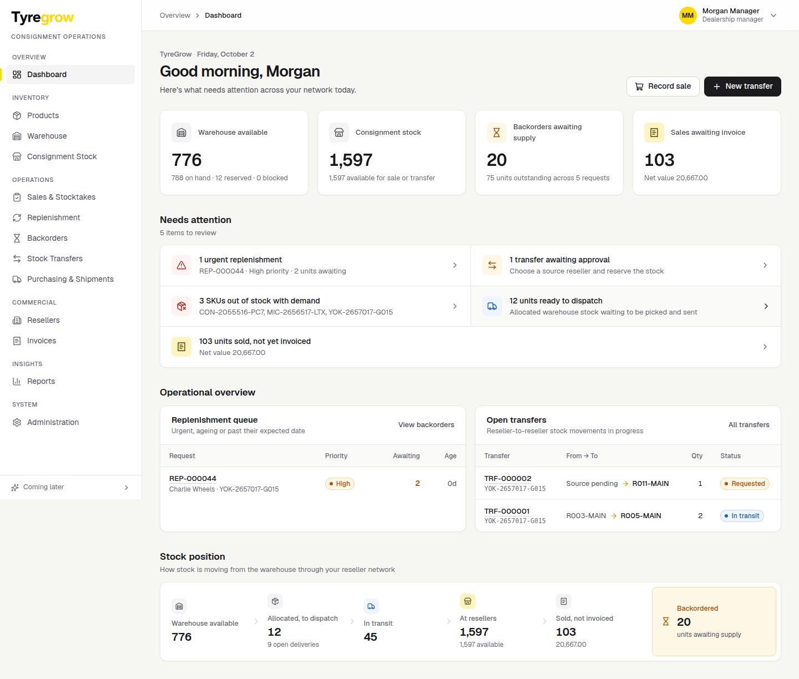

# TyreGrow — Design System

Direction approved 2026-10-22 (Inter, neutral role dashboards, yellow as accent only).

Tokens live in `frontend/src/app/globals.css` (`@theme`); Tailwind turns each one into utilities.
Use the tokens and the shared components in `frontend/src/components/ui.tsx`. Do not type hex colours, pixel font
sizes or Tailwind palette greys (`zinc-*`) into screens.

**Feel:** calm, controlled, operational, trustworthy, easy to scan. Every screen answers *what needs my attention?*
first. Order of information: **status → exception → action → detail**. No decoration for its own sake.

## Where things live

| What | File |
|---|---|
| Design tokens (colours, type scale, spacing, radius, shadow) | `frontend/src/app/globals.css` (`@theme`) |
| Product name, descriptor, tagline, logo, UI thresholds | `frontend/src/config/branding.ts` |
| Logo asset (transparent PNG, 960×218) | `frontend/public/brand/tyregrow-logo.png` |
| App icon | `frontend/src/app/icon.png`, `apple-icon.png` |
| Core components | `frontend/src/components/ui.tsx` |
| Stock-movement components | `frontend/src/components/flow.tsx` |
| App shell (sidebar, header, user menu) | `frontend/src/components/AppShell.tsx` |
| Font file and licence | `frontend/src/app/fonts/` (loaded in `frontend/src/app/layout.tsx`) |

To rebrand, change the tokens and `branding.ts`. No page needs to change.

## Typography

Inter, self-hosted (`frontend/src/app/fonts/InterVariable.woff2`, SIL Open Font License; subset to Latin, Latin
Extended-A including Māori macrons, and the symbols the app uses). Never loaded from Google at runtime.

| Token / utility | Size / line | Weight | Use |
|---|---|---|---|
| `text-display` | 28 / 36 px | 700 | Page heading, desktop |
| `text-display-compact` | 24 / 32 px | 700 | Page heading, mobile |
| `text-heading` | 18 / 26 px | 600 | Section heading |
| `text-subheading` | 16 / 24 px | 600 | Card title |
| `text-metric` | 30 / 36 px | 600 | KPI number, desktop (`text-metric-compact` 24 px on mobile) |
| `text-body` | 14 / 20 px | 400 | App text and tables (the default) |
| `text-body-lg` | 16 / 24 px | 400 | Forms and inputs on mobile, warehouse screens |
| `text-label` | 13 / 18 px | 500 | Form labels, table headers |
| `text-caption` | 12 / 16 px | 500 | Badges, metadata. **Nothing smaller than 12 px.** |
| `text-button` / `text-button-lg` | 14 / 16 px | 600 | Buttons |

Weights: **400, 500, 600, 700 only.** Number and identifier helpers:

- `sku`: SKU codes, account references, document numbers. Inter 500, equal-width digits, slashed zero. Not monospace.
- `data` (or `num`): equal-width digits for quantities and tyre sizes compared down a column; right-align them.
- Tyre size: 14 px / 600 for `195/65R15`, the load/speed part (`91H`) in secondary text.
- Mobile input text is at least 16 px (iPhone Safari zooms into smaller fields).

## Colour

| Token | Value | Use |
|---|---|---|
| `canvas` | `#F8F8F5` | Page background |
| `surface` | `#FFFFFF` | Cards |
| `subtle` | `#F3F2EE` | Table headers, hover, quiet panels |
| `ink` | `#1C1C1E` | Text and charcoal surfaces (primary buttons) |
| `ink-secondary` | `#68676F` | Secondary text (5.6:1) |
| `ink-muted` | `#737279` | Captions and metadata **on white** (4.8:1; 4.5:1 on canvas, so use secondary there) |
| `ink-disabled` | `#A3A1A8` | Disabled controls only. Placeholders use `ink-muted`, because they often carry hints ("Size e.g. 205/55") |
| `line` | `#E4E3DF` | Dividers and card borders |
| `control` | `#8E8C86` | Input, select and checkbox borders (3.4:1, as WCAG 1.4.11 asks) |

**Brand yellow is an accent, not a status and not a call to action.**

| Token | Value | Use |
|---|---|---|
| `brand` | `#FFD400` | Logo, active navigation marker, selected state, current step in a workflow, occasional highlight. Always with ink text on top. Never text, icons or focus rings on white (1.4:1). |
| `brand-soft` | `#FFF8D6` | Selected row or navigation tint |
| `brand-text` | `#806B00` | Yellow-family text or icon on white (5.2:1) |

**Status colours carry operational meaning only**, always with a label or icon (never colour alone):

| Meaning | Text / icon | Background | Examples |
|---|---|---|---|
| Success | `#16803C` | `#EDF7EF` | On target, delivered, completed, approved, received, invoiced |
| Warning (needs attention) | `#8F5600` | `#FFF7DE` | Someone must notice or act: below target, stock check due, overdue, re-check requested, disputed, backorder, not yet invoiced, on hold, missing details |
| Danger (critical) | `#C6372C` | `#FFF1F0` | Out of stock with demand, rejected, urgent, discrepancy, failed |
| Info | `#2C6AB3` | `#EFF6FF` | Work in progress: under review, allocated, ready for shipment, shipped, in transit, transfer |
| Neutral | `#68676F` | `#F1F0EC` | Informational or waiting in the normal flow: draft, submitted, requested, open, closed, cancelled |

The mapping lives in one place, `STATUS_TONES` in `frontend/src/components/ui.tsx`. A screen passes `tone` only when the same
value means something different there (for example "Missing details" is amber because someone must complete them).

Roles are never colour-coded: every dashboard uses the same neutral structure, and a role is named in text or with an
icon.

## Buttons

| Variant | Look | Use |
|---|---|---|
| Primary | Charcoal background, white text | The main action of an area. One per area. Sign in is primary. |
| Secondary | White background, `line-strong` border, charcoal text | Everything else |
| Ghost | No border | Low-emphasis actions in toolbars and rows |
| Danger | Red background, white text | Confirming a destructive action (Void, Reject), ideally inside the confirm dialog |

Yellow is not a button colour for normal actions. Heights: 32 / 36 / 44 px (`h-control-sm/md/lg`); **44 px minimum on
touch and warehouse screens**. Text 14 px / 600 (16 px when large).

## Spacing and layout

- 4 px grid: 4, 8, 12, 16, 20, 24, 32, 40, 48 px (Tailwind `1 2 3 4 5 6 8 10 12`). No other values.
- Page gutter `px-page`: 16 px mobile, 24 px tablet, 32 px desktop. Content width up to `max-w-content` (1440 px).
- Card padding `p-card`: 16 px mobile, 20 px desktop. Radius: cards 12 px (`rounded-card`), controls 8 px
  (`rounded-control`), pills `rounded-pill`.
- Table rows 44 px (`h-row`), 40 px compact (`h-row-compact`).
- Focus: `focus-ring` (2 px charcoal outline, 2 px offset), visible on every background.

## The operational loop

Warehouse → Dealer → Sale → Replenishment → Warehouse, drawn as a closed loop in charcoal with yellow only on the
current step. Used on the login page, empty states and the progress strip of a sale or replenishment, not as
decoration on dashboards.

## Components

| Component | Use |
|---|---|
| `PageHeader` | Page title, subtitle, optional eyebrow, meta line and actions |
| `Card`, `SectionHeader` | Grouped content; section headings on a page |
| `Stat` / `KpiCard` | Primary KPIs (icon chip, value, one line of context) |
| `MetricStrip` | Several related metrics in one surface, used in page headers |
| `Badge` / `StatusBadge` | Statuses mapped to five tones: success, warning, critical, info and neutral (plus accent). The label is always shown |
| `DataTable` | Search, sorting with keyboard-accessible headers, skeleton loading, empty state, error, row hover, "show more" |
| `QuickFilters`, `FilterBar`, `SearchInput` | Queue-style filtering |
| `ActionMenu` | Compact "⋯" menu for secondary row actions |
| `EmptyState`, `Skeleton`, `Loading`, `Alert` | Feedback states |
| `Modal`, `Drawer`, `ConfirmDialog` | Dialogs; confirmations can require an audited reason |
| `Tabs` | Underline tabs with optional counts |
| `ProductCell` | Tyre identity in tables: product name prominent, size and SKU secondary |
| `Timeline`, `MiniProgress` | Lifecycle progress (for example Requested → Approved → In transit → Received) |
| `FlowPath`, `FlowInline`, `StockPipeline` | FROM → TO movements, and warehouse → reseller → sold flow |
| `Logo` | The wordmark at its intrinsic aspect ratio. Pass a height class only |
| `OperationalLoop` | Warehouse → Dealer → Sale → Replenishment → Warehouse as a closed 2 × 2 cycle, yellow on Replenishment only (login page; reusable for empty states) |

## Tables on phones and tablets

`DataTable` (in `ui.tsx`) has one set of rows and two phone presentations. Pick by the user's task, not by the device.

| Setting | Use |
|---|---|
| `mobile="cards"` | Operational lists people scan and act on. Below 640px each row is a card: identifier and status, 2–4 fields, the main action. Same table restyled, with explicit table roles. |
| `mobile="scroll"` (default) | Ledgers, audit history, allocation grids, financial or document-like tables. The table scrolls inside its card with edge fades. The page never scrolls sideways. |
| `pin: true` on the first column | Keeps the identifier in view while a scrolling table moves (for example the transaction number in Stock movement). |
| `density="comfortable"` | Warehouse tables. On touch screens: 52px rows, 16px / 600 quantities. With a mouse it is the normal 44px table. |
| `label` | Accessible name of the table and its scroll area ("Stock movements, scrolls sideways"). |

Column settings for card mode (`mobile` on a column):

| Value | Shows as |
|---|---|
| `primary` (default for the first column) | Identifier, top left |
| `status` | Status badge, top right |
| `secondary` | One quiet line under the identifier (for example the tyre size) |
| `field` | A label / value line (`mobileLabel` overrides the header; `mobileOrder` sorts fields) |
| `action` | The row's main action, at the bottom of the card |
| `hidden` (default for the other columns) | Not on the card (it stays on the detail page) |

Filters and sorting on phones (below 640px):

| Setting | Use |
|---|---|
| `filters` + `filterCount` + `onClearFilters` | Search stays in view; the other filters move into a bottom sheet behind **Filters (n)**, where n is how many differ from their default. The sheet has **Clear all** and **Apply**. Wrap each filter in `FilterField label="…"` so the sheet shows its label. The filters work exactly as on desktop; only where they are shown changes. |
| `mobileSort` on a column | Offers that column under **Sort by** (with Ascending / Descending) in the same sheet. Only columns people really sort by; a string sets the label. Desktop header sorting is unchanged and shares the same state. |
| `quickFilters` | Quick-filter chips stay visible: one row that scrolls sideways inside itself on phones, 44px chips, never wrapping. |

Use `numeric: true` (or `align: "right"`) for quantities. Use `TableCheckbox` for row selection: a compact box with a 44 × 44px tap area.
Small controls use the `touch-target` utility: they keep their look and answer taps across 44 × 44px on touch screens.

## Actions on phones and tablets

Below 1024px (phones and tablets in portrait) a workflow keeps **one clear primary action within reach at the bottom
of the screen**. Wider screens keep the header actions as they are.

| Piece | Use |
|---|---|
| `MobileActionBar` | The page's one primary action (plus Back, Cancel or Save draft if the step needs them), docked at the bottom with the iPhone safe area. Put it **after** the content it acts on, so the focus order is content → action. `desktop="inline"` (default) shows it in place on wide screens, for form buttons; `desktop="hidden"` when the page header already shows the action there. |
| `PageHeader mobileActions` | What the header shows instead of `actions` below 1024px: usually a `MoreMenu`. |
| `PageHeader status` | A short note before the actions at every size, such as who the next step is waiting for. Rendered once; workflow state is never hidden in a menu. |
| `MoreMenu` | Secondary actions: a labelled "More" button (44px on touch), items 44px tall with visible labels, keyboard support (↓, ↑, Home, End, Escape returns focus to the button). Destructive items come last after a divider, in red, and say what they do ("Cancel request", "Void invoice record"). With one item it shows a plain button. |

Rules:

- One primary action on screen: an action in the bar is not also shown elsewhere at the same time (the header or card copy is `max-lg:hidden`).
- Pages with several equal choices (Pick & dispatch with more than one destination) keep a button on each card instead of a bar.
- The bar publishes its height as `--action-bar-height`: the page gets that much bottom padding (the last field is never covered), focused fields scroll clear of it, and notifications dock above it.
- While a text field is focused on a touch screen (the on-screen keyboard is open), the bar drops back into the page instead of floating over the field.
- Dialogs never get the bar. On phones a dialog's footer stays at the bottom of the screen while a long dialog scrolls.
- Notifications: on phones and touch tablets they dock at the bottom, above the bar, clear of the header buttons; on a desktop with a mouse they stay top right.

## Navigation by screen size

| Width | Navigation |
|---|---|
| Below 1024px | Menu button in the top bar opens the navigation drawer |
| 1024–1279px (tablet landscape) | 64px icon rail. Each icon has its page name for screen readers and as a tooltip; the current page has the tinted background and the yellow marker. **Expand navigation** (44px) shows the labels over the page; it collapses on navigation, Escape or a tap outside. Gives about 190px back to tables. |
| 1280px and wider | The full sidebar |

## Rules

- Primary actions are charcoal (see Buttons). Destructive actions are red.
- Statuses are never shown by colour alone: badges carry text and timelines carry screen-reader text.
- Every interactive element has a visible focus ring (`focus-ring` or `outline-ink`). Icon-only buttons have an `aria-label`.
- Tables use subtle horizontal separators, rows of 44px (`h-row`), and nowrap cells. Only long free-text columns wrap.
- Coming-later features are hidden under the sidebar's **Coming later** section, not shown as disabled links.

## Rollout

The direction is applied in phases: 1 foundation (Inter, tokens), 2 shared components, 3 screen cleanup (role colours, yellow statuses, hard-coded colours and sizes, `zinc-*` greys, old token names removed), 4 mobile and touch, 5 login page (approved type scale, no decoration, the operational loop). Every screen, the login page included, now uses the tokens.
