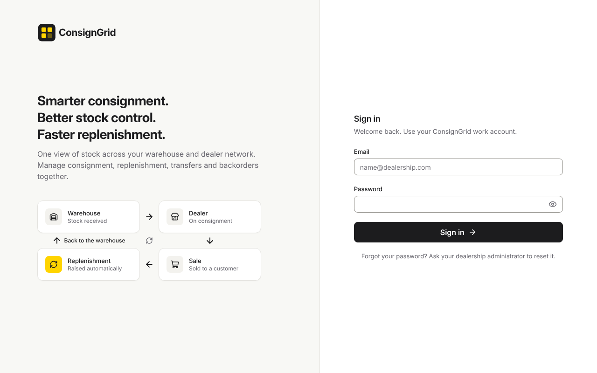
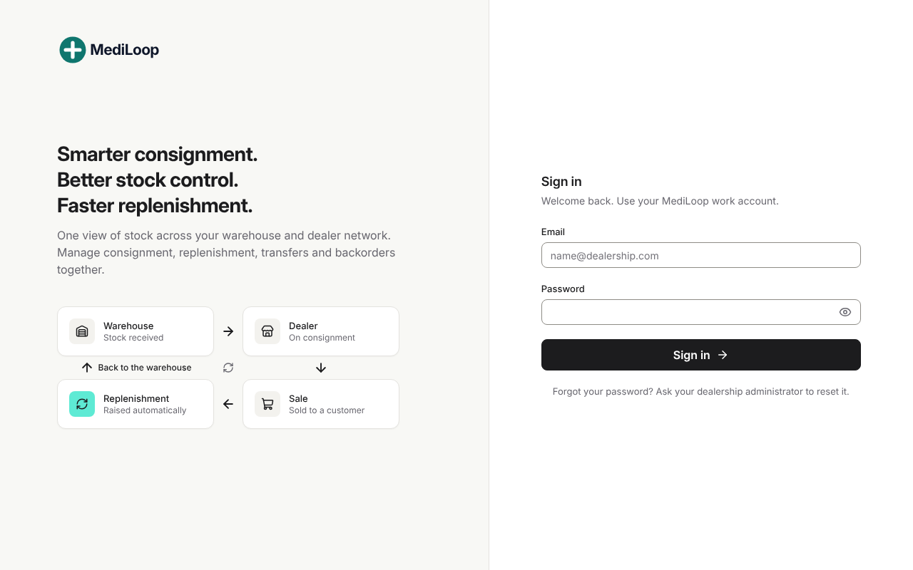

# Customer playbook — branding and configuring a new customer

This page is the checklist for turning ConsignGrid into "a customer's own product". It grows with each phase: what
is listed under **Available now** works today; the rest is planned (see `01_MASTER_PLAN.md`).

| Default brand | Same build, different Brand Pack (fictional "MediLoop") |
|---|---|
|  |  |

## 1. Brand Pack — available now (Phase 1.1)

Two names, on purpose:

- **Product name**: the software's name. Ours (ConsignGrid) or the white-label reseller's. Shown in the tab title,
  on sign-in, as the API title and as the "system" actor ("posted by StockLoop automatically").
- **Company name**: the supplier running the consignment programme, as its dealers know it. Shown in dealer-facing
  messages ("Acme Tyres will call you", "Messages from Acme Tyres"), download file names, delivery notes and
  invoices. Defaults to the product name.

### Backend (`backend/.env`)

| Variable | Example | Used for |
|---|---|---|
| `APP_DISPLAY_NAME` | `StockLoop` | API title, `/api/health`, system actor, import template |
| `COMPANY_NAME` | `Acme Tyres` | Dealer messages, file names (`Acme-Tyres_SKUs_2026-11-11.xlsx`) |
| `INVOICE_ISSUER_NAME` / `INVOICE_ISSUER_DETAILS` | `Acme Tyres Limited` / address, tax number | Invoices and delivery notes (empty = company name) |
| `SMTP_FROM` | `Acme Tyres <deliveries@acmetyres.com>` | Delivery-note emails |
| `SUPPORT_EMAIL` | `support@acmetyres.com` | Reserved for the support link (Phase 1.3) |
| `DEFAULT_CURRENCY`, `BUSINESS_TIMEZONE` | `AUD`, `Australia/Sydney` | Invoices, dates, daily jobs |
| `REFERENCE_DOCUMENTS_DIR` | `/srv/brand/reference` | The customer's own price lists (folder + `manifest.json`) |

### Frontend (`frontend/.env.local`, built into the bundle — rebuild after changes)

| Variable | Example |
|---|---|
| `NEXT_PUBLIC_BRAND_NAME` | `StockLoop` |
| `NEXT_PUBLIC_BRAND_COMPANY` | `Acme Tyres` |
| `NEXT_PUBLIC_BRAND_DESCRIPTOR` | `Dealer Stock` (under the sidebar logo) |
| `NEXT_PUBLIC_BRAND_TAGLINE` | meta description |
| `NEXT_PUBLIC_BRAND_LOGO` (+ `_WIDTH`, `_HEIGHT`) | `/brand/acme.svg` (put the file in `frontend/public/brand/`; give its intrinsic size) |
| `NEXT_PUBLIC_BRAND_ACCENT`, `_HOVER`, `_SOFT`, `_TEXT` | `#5eead4`, `#99f6e4`, `#ccfbf1`, `#0f766e` |
| `NEXT_PUBLIC_BRAND_SUPPORT_EMAIL` | `support@acmetyres.com` |

Also replace `frontend/src/app/icon.svg` (browser tab icon) and `frontend/src/app/apple-icon.png` (180×180).

**Accent rules (accessibility):** the accent is a *fill* that always carries dark text, so choose a light, saturated
colour (contrast with `#1c1c1e` ≥ 4.5:1). `ACCENT_TEXT` is used for text and icons on white and must reach 4.5:1.
Never use the accent for statuses (green/amber/red keep their operational meaning).

### Guard rail
`backend/tests/test_brand_pack.py` fails the build if the previous customer's brand appears anywhere in the
product's code, assets or file names. Add a new line to that test if a future customer leaves.

## 2. Industry Pack — planned (Phase 1.2–1.4)
Choose `tyres` (default), `generic`, `auto_parts`, `medical`, `industrial`, … Sets the words (Dealer / shop / tyre),
item attributes, label format, import template and default rules.

## 3. Policy — partly available
Available as settings today: currency, find window for stock checks, stock-check frequency, request limits,
low-stock threshold, transfer consent per dealer agreement, payment terms per dealer, tax rates in Administration.
Planned: billing trigger (on sale / on use / periodic), multi-currency, tax profiles.

## 4. New-customer checklist (silo deployment)

1. Create the database and run `alembic upgrade head`.
2. Fill the Brand Pack (backend `.env`, frontend `.env.local`, logo and icons) and build the frontend.
3. Create the Administrator: `python -m scripts.create_admin` (see `docs/PILOT_USERS.md`).
4. Administration → Tax rates: set the customer's rate(s).
5. Products → Import products (download the template; it carries the brand name).
6. Add dealers (their account references are generated), set targets, record initial stock for existing dealers.
7. Put the customer's reference documents (if any) in `REFERENCE_DOCUMENTS_DIR`.
8. Smoke test: sign in as each role; check `/api/health` shows the customer's product name.
